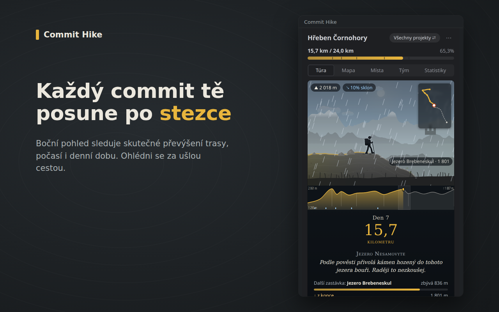
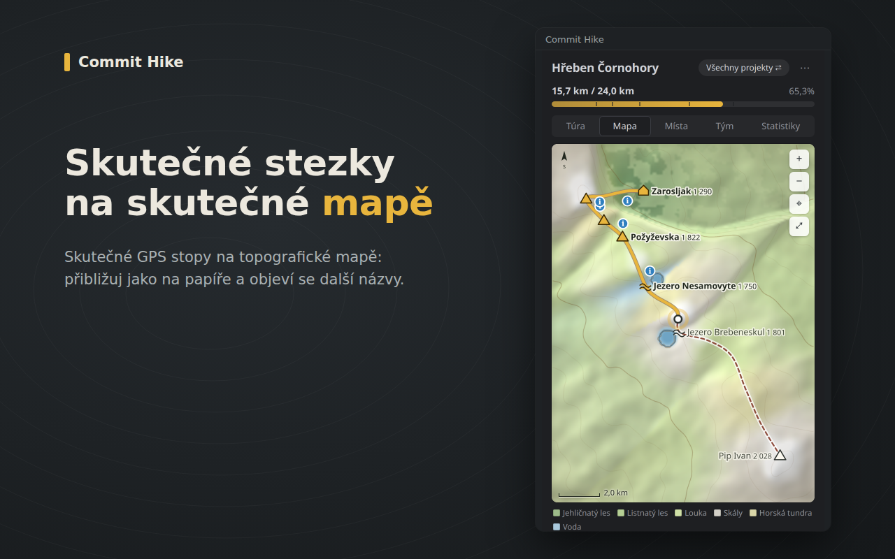
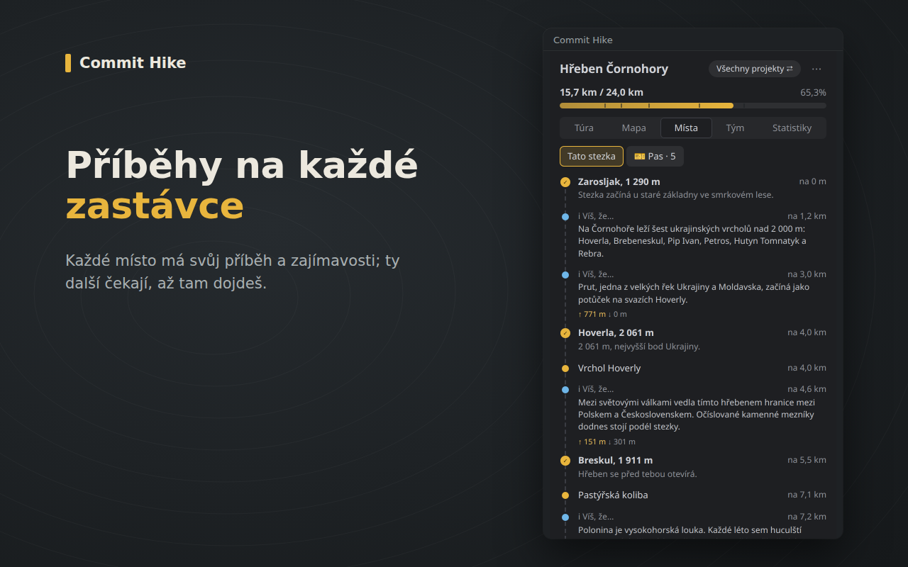
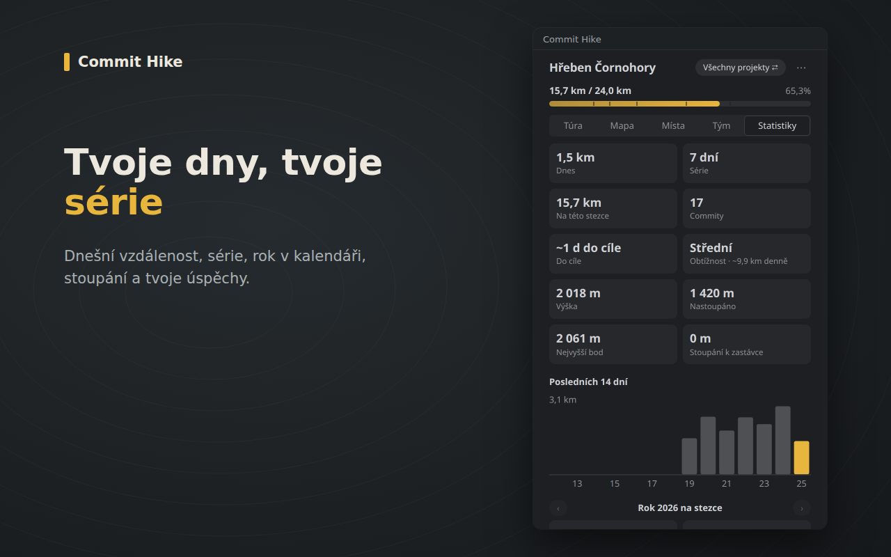
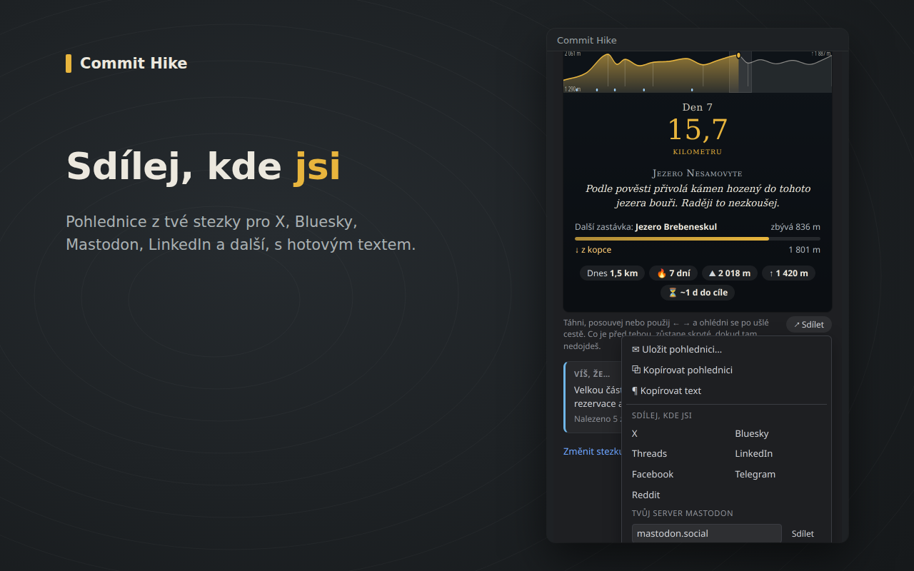

# Commit Hike

[](https://plugins.jetbrains.com/plugin/34595)
[](https://plugins.jetbrains.com/plugin/34595)
[](https://open-vsx.org/extension/shchusia/commit-hike)
[](https://open-vsx.org/extension/shchusia/commit-hike)
[](https://github.com/Shchusia/Commit-Hike)
[](../LICENSE)

[](https://commit-hike.dev)

*[English](../README.md) · [Українська](README.uk.md) · [Polski](README.pl.md) · [Deutsch](README.de.md) · [Español](README.es.md) · [Čeština](README.cs.md) · [Co je nového](../CHANGELOG.md)*

Každý tvůj commit tě posune po turistické stezce, přímo v IDE. Den poctivé
práce tě zavede asi deset kilometrů po skutečném horském hřebeni, přes poušť
nebo pohádkou — se scénou, která se cestou mění, mapou, příběhy,
zajímavostmi a úspěchy.

<p>
  
  
</p>
<p>
  
  
</p>

## Funkce

- **Skutečné, literární i autorské trasy.** Čornohora přes Hoverlu a novozélandský Tongariro Alpine Crossing po skutečných GPS stopách, Santiagova cesta z „Alchymisty“ skutečným Španělskem, Marokem, Saharou a Egyptem, pohádka v Karpatech nebo fantasy putování kolem sedmi majáků. Každá trasa má vlastní zastávky, příběh, zajímavosti a úspěchy.
- **Trasy z webu.** Hledej trasy ostatních turistů na [commit-hike.dev](https://commit-hike.dev) přímo v IDE: vyhledávání, filtry, obálky, hodnocení; instalace jedním kliknutím a aktualizace, když autor vydá novou verzi. V Neovimu: `:CommitHike find`.
- **Šest jazyků.** Angličtina, ukrajinština, polština, němčina, španělština a čeština — podle IDE nebo podle výběru v nastavení.
- **Série.** Dokonči trasu a pokračuj dál: Karpaty (Čornohora → Svydovec → Gorgany) a dlouhé cesty (Tour du Mont Blanc → Camino Francés do Santiaga).
- **Opravdové stoupání.** Trasy mají výškové profily: terén stoupá a klesá a ty vidíš nadmořskou výšku, sklon, nastoupané metry a stoupání k další zastávce.
- **Živá scéna.** Obloha se řídí tvými hodinami, počasí se mění den ode dne a krajina — lesy, louky, step, poušť, skály, sníh, jezera, moře, sopky — plynule přechází jedna v druhou. V zimě sníh, na podzim zlaté louky, ve dnech bez commitů tábor u ohně.
- **Mapa a minimapa.** Topografická mapa celé stezky: vrstevnice, stínování, lesy a jezera; skutečné trasy podle GPS stopy ve skutečném měřítku.
- **Skutečné vzdálenosti, tvoje obtížnost.** Typický den commitů je asi 10 km na střední obtížnost (12,5 na lehkou, 8 na těžkou), takže dlouhá trasa je cíl na měsíce.
- **Bez spoilerů.** Cestu, kterou máš za sebou, si můžeš prohlédnout, ale co leží před tebou, uvidíš až na místě.
- **Rok na stezce a pas.** Kalendář aktivity, nejlepší den, nejdelší série a v pasu razítko s datem za každou zastávku.
- **Sdílej.** Pohlednice z místa, kde právě jsi: ulož ji, zkopíruj nebo zveřejni na X, Bluesky, Mastodonu, Threads, LinkedInu, Facebooku, Telegramu nebo Redditu s připraveným textem.
- **I v terminálu.** Jeden řádek ve výzvě shellu (starship, bash, zsh, fish) a ve stavovém řádku Neovimu, ze stejného jádra: `🥾 16,0 km · Jezero Nesamovyte`.
- **Choďte spolu.** Všichni, kdo commitují do projektu, na jedné stezce, s žebříčkem, přehledem týdne a týmovým cílem: trasou, kterou jdete společně a na které se sčítají commity všech.
- **Férová vzdálenost.** Metry rostou s velikostí commitu, od pár kroků za jednořádkovou opravu po skoro 4 km za velkou změnu, a rychleji než asi 5 km za hodinu nepůjdeš: drobné commity ani commity v dávkách nic nepřinesou, zatímco dlouhý pracovní den se počítá celý, pozdní commity taky. Lock soubory, generovaný kód, změny jen v mezerách a cizí commity se nepočítají; po squash, rebase nebo amend se historie přepočítá, nikdy se nepočítá dvakrát.
- **Soukromí na prvním místě.** Nic se nezapisuje do tvých repozitářů a nic o tobě neopouští tvůj počítač: jediné požadavky jdou na [commit-hike.dev](https://commit-hike.dev), když otevřeš *Trasy z webu* nebo instaluješ trasu, a čtou veřejný katalog, aniž by o tobě cokoli posílaly. Neukládáme kód, zprávy commitů, názvy souborů ani repozitářů.

## Podporovaná IDE

| IDE | Kde získat |
|---|---|
| IDE JetBrains 2024.3+: PyCharm, IntelliJ IDEA, GoLand, WebStorm, PhpStorm, RubyMine, CLion, Rider… | [JetBrains Marketplace](https://plugins.jetbrains.com/plugin/34595) |
| VSCodium, Cursor, Windsurf a další editory, které používají Open VSX | [Open VSX](https://open-vsx.org/extension/shchusia/commit-hike) |
| VS Code 1.85+ | brzy ve Visual Studio Marketplace; do té doby nainstaluj `.vsix` z Open VSX |
| Neovim 0.10+ a libovolná výzva shellu: starship, bash, zsh, fish | [commit-hike.nvim](https://github.com/Shchusia/commit-hike.nvim), [docs/terminal.md](terminal.md) |
| Zed | přes jeho terminál, viz [docs/terminal.md](terminal.md#zed) |

## Instalace

**IDE JetBrains.** Otevři **Settings → Plugins → Marketplace**, vyhledej
*Commit Hike* a klikni na **Install**.

**VSCodium, Cursor, Windsurf.** Otevři zobrazení rozšíření, vyhledej
*Commit Hike* a klikni na **Install**.

**VS Code.** Dokud Commit Hike není ve Visual Studio Marketplace, stáhni
`.vsix` ze [stránky Open VSX](https://open-vsx.org/extension/shchusia/commit-hike)
(**Download**) a pak ve VS Code: zobrazení rozšíření, **⋯ → Install from VSIX…**.

**Terminál a Neovim.** Nainstaluj jádro jedním příkazem a pak ho přidej do
výzvy shellu nebo do stavového řádku, viz [docs/terminal.md](terminal.md):

```sh
curl -fsSL https://raw.githubusercontent.com/Shchusia/Commit-Hike/master/scripts/install.sh | sh
```

V Neovimu 0.10+ s lazy.nvim, a pak přidej `require("commit-hike").statusline` do stavového řádku:

```lua
{ "Shchusia/commit-hike.nvim", version = "*", opts = {} }
```

## Jak na to

Otevři okno **Commit Hike** (JetBrains) nebo zobrazení Commit Hike na panelu
aktivit (VS Code). Napoprvé se tě krátké nastavení zeptá, které projekty se
počítají a odkud cesta začíná. Pak už jen commituj.

Karty: **Túra** (scéna, dnešní vzdálenost, příběh místa), **Mapa**,
**Místa**, **Tým** a **Statistiky**. Všechno ostatní — výběr trasy, vlastní
trasy, ikonu turisty, obtížnost, jazyk — najdeš v **Tools → Commit Hike**
(JetBrains) nebo v paletě příkazů pod *Commit Hike* (VS Code).

**↗ Sdílet** pod túrou (a na pohlednici roku ve statistikách) uloží nebo
zkopíruje pohlednici, nebo otevře příspěvek s připraveným textem; pohlednice
už je ve schránce, stačí ji vložit.

<p></p>

## Pro vývojáře

Sestavení, testy, vydání, architektura a přidávání tras jsou popsané v
[anglickém README](../README.md#development) a v [docs/](./). Překlady tras
a rozhraní jsou vítány: viz [docs/routes.md](routes.md).
Vydání, včetně pluginu pro Neovim, popisuje [docs/publishing.md](publishing.md).

## Podpoř projekt

Commit Hike je zdarma a open source. Jestli tě ta túra baví:

- ⭐ dej repozitáři hvězdičku — pomůže to ostatním ho najít;
- ohodnoť plugin na [JetBrains Marketplace](https://plugins.jetbrains.com/plugin/34595) nebo [Open VSX](https://open-vsx.org/extension/shchusia/commit-hike/reviews);
- hlas chyby a nápady v [issues](https://github.com/Shchusia/Commit-Hike/issues);
- vytvoř trasu a poděl se o ni: viz [docs/routes.md](routes.md).

## Licence

[MIT](../LICENSE)
